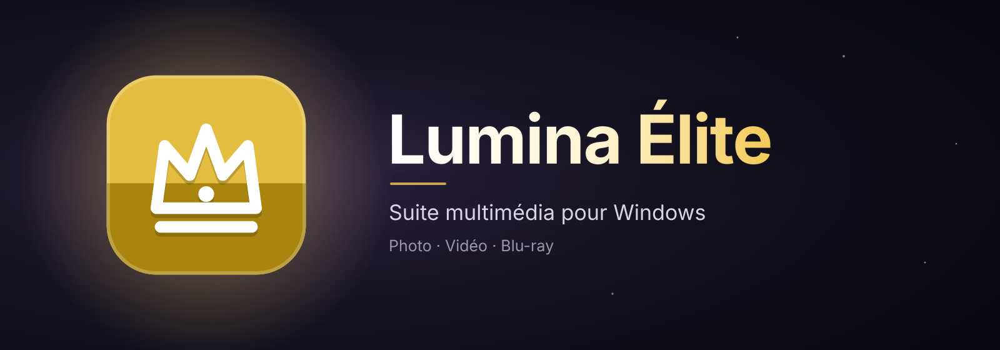
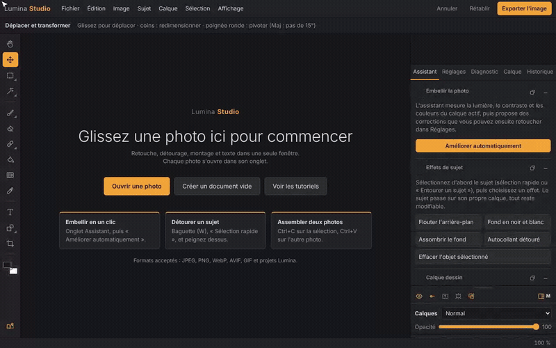

  

  

  
  
  
  

---

## ✨ Pourquoi Lumina Élite

Lumina Élite réunit dans un seul fichier une collection de logiciels pour **créer, monter et sublimer vos souvenirs** : photos, vidéos et disques Blu-ray. Vous choisissez ceux que vous voulez, ils s'installent en quelques secondes.

<table>
<tr><td width="230">🎯 <b>Simple</b></td><td>Pensé pour être pris en main tout de suite, avec des astuces et des tutoriels intégrés.</td></tr>
<tr><td width="230">🏆 <b>Résultat pro</b></td><td>Des fonctions dignes des grands logiciels, sans leur complexité.</td></tr>
<tr><td width="230">🔄 <b>Toujours à jour</b></td><td>Un clic sur « Mettre à jour Lumina Élite » et vous avez les dernières nouveautés.</td></tr>
<tr><td width="230">🔒 <b>Respect de la vie privée</b></td><td>Aucun compte, aucune publicité, aucun pistage. Vos fichiers ne quittent jamais votre PC.</td></tr>
<tr><td width="230">&nbsp;<b> En français</b></td><td>Entièrement en français, de l'installation aux réglages.</td></tr>
</table>

<h2>&nbsp; Lumina Studio</h2>

Une photo un peu terne ? Un clic sur « Améliorer automatiquement » corrige la lumière, le contraste et les couleurs. Essayez ensuite une ambiance (heure dorée, cinéma, noir et blanc…), transformez la photo en dessin au crayon, et affinez chaque réglage à votre goût. Rien n'est définitif : tout reste modifiable.

Et quand l'intelligence artificielle s'en mêle (**Bêta**) : un clic sur un sujet pour le détourer ou changer l'arrière-plan, une phrase en français pour ajouter un objet à la photo, l'effacement d'une personne en trop, la colorisation des vieilles photos noir et blanc et des retouches portrait automatiques.

## 🧩 Les autres logiciels de la suite

<table>
<tr><td width="230">💿 <b>Lumina Opus</b></td><td>Transforme tes vidéos en vrais Blu-ray avec menus animés (neige, étoiles, reflet sur le titre…), lus par n'importe quelle platine, avec ou sans Java. Il sait aussi reprendre un ancien disque ISO pour le remanier.</td></tr>
<tr><td width="230">🎬 <b>Lumina Motion</b></td><td>Montage vidéo multipiste : écran partagé, étalonnage, effets, audio soigné, vidéos de téléphone, GoPro et Ray-Ban Meta, puis envoi direct vers Lumina Opus.</td></tr>
<tr><td width="230">🖨️ <b>Lumina Cover</b></td><td>Jaquettes Blu-ray, DVD et CD prêtes à imprimer en taille réelle, avec textes libres, calques et séries de disques.</td></tr>
<tr><td width="230">✨ <b>Lumina Clarity</b> <b>Bêta</b></td><td>Agrandit et améliore les vieilles vidéos en HD grâce à l'IA (animation et vidéos réelles), jusqu'en 4K, avec reprise automatique.</td></tr>
</table>

## 🧪 Fonctions en Bêta

Tout ce qui utilise l'**intelligence artificielle** est marqué **Bêta** : le clic IA, le détourage, le remplacement de l'arrière-plan, le remplissage génératif, l'effacement d'objets, la colorisation et les filtres portrait de Lumina Studio, ainsi que tout Lumina Clarity. Ces fonctions marchent déjà, mais elles s'améliorent encore à chaque version, et le résultat peut varier selon les images et la carte graphique. Tout se calcule sur votre PC : rien n'est envoyé en ligne. Vos retours sont précieux pour les faire progresser !

## 📥 Installation

1. **Téléchargez** [Lumina Élite](https://github.com/LuminaCreator/Lumina-Elite/releases/latest/download/LuminaElite.exe) (fichier LuminaElite.exe, environ 190 Mo).
2. **Ouvrez-le.** Windows peut afficher « Windows a protégé votre ordinateur » : c'est normal pour un logiciel indépendant. Cliquez sur **Informations complémentaires**, puis sur **Exécuter quand même**.
3. **Choisissez vos logiciels** et cliquez sur **Installer**. Ils apparaissent dans le menu Démarrer et, si vous le souhaitez, sur le Bureau.

> Votre antivirus peut demander une vérification la première fois : autorisez simplement le fichier.

## 🔄 Mises à jour

Lumina Élite vérifie au démarrage si une nouvelle version existe. Si c'est le cas, un bouton **« Mettre à jour Lumina Élite »** apparaît : un clic suffit. Le fichier téléchargé est contrôlé avant d'être installé ; s'il est incomplet, rien n'est modifié.

Les notes de chaque version se trouvent dans les [Releases](https://github.com/LuminaCreator/Lumina-Elite/releases).

## 💻 Configuration conseillée

- Windows 10 ou 11, 64 bits
- 1 Go d'espace libre pour la suite (davantage pour vos projets vidéo)
- Connexion Internet au premier lancement et pour les mises à jour
- Un graveur Blu-ray pour graver vos disques
- Pour les fonctions IA (Bêta) : une carte graphique récente est conseillée (elles marchent aussi sur le processeur, plus lentement)

## 👋 À propos

<table>
<tr>
<td width="120" align="center"></td>
<td>

**Lumina Élite** est un projet personnel de **LuminaCreator**. Tout est parti d'une envie simple : avoir des logiciels beaux, agréables et vraiment pratiques pour garder et sublimer mes souvenirs — photos, vidéos et Blu-ray faits maison.

Ces outils, je les utilise moi-même au quotidien, et je les améliore régulièrement. Je les partage gratuitement, sans publicité ni collecte de données, en espérant qu'ils vous rendront service autant qu'à moi.

</td>
</tr>
</table>

<table>
<tr><td width="230">🛠️ <b>Conçu avec soin</b></td><td>Chaque logiciel est pensé pour être simple au premier abord et complet quand on va plus loin.</td></tr>
<tr><td width="230">🔒 <b>Vos fichiers restent chez vous</b></td><td>Aucun compte, aucun envoi : tout se passe sur votre PC.</td></tr>
<tr><td width="230">💬 <b>À votre écoute</b></td><td>Une idée, un bug ? Écrivez-moi dans l'onglet <a href="https://github.com/LuminaCreator/Lumina-Elite/issues">Issues</a>.</td></tr>
</table>

## ❓ Questions fréquentes

<b>Est-ce vraiment gratuit ?</b>

Oui, entièrement, sans publicité ni abonnement. À la base, je crée ces logiciels pour moi et par plaisir : je partage simplement les outils que j'utilise au quotidien, en espérant qu'ils vous seront utiles aussi.

<b>Mes projets sont-ils envoyés quelque part ?</b>

Non. Tout reste sur votre PC. Lumina Élite se connecte seulement pour savoir si une nouvelle version est disponible.

<b>Comment désinstaller ?</b>

- **Un seul logiciel :** dans Lumina Élite, onglet « Mes logiciels », cliquez sur l'icône de corbeille du logiciel.
- **Toute la suite :** dans les Paramètres de Windows, « Applications installées », choisissez Lumina Élite puis « Désinstaller » (ou passez par les Réglages de Lumina Élite). Vous pouvez retirer en même temps tous les logiciels Lumina.

Dans tous les cas, vos projets, photos, vidéos et documents sont conservés.

## 💬 Vos idées et vos retours

N'hésitez pas à me dire ce que vous aimeriez voir dans les logiciels, ou à me signaler un bug : j'interviens régulièrement. Le plus simple est d'ouvrir un message dans l'onglet [Issues](https://github.com/LuminaCreator/Lumina-Elite/issues) (un compte GitHub gratuit est nécessaire).

---

Lumina Élite · créé par <b>LuminaCreator</b>

